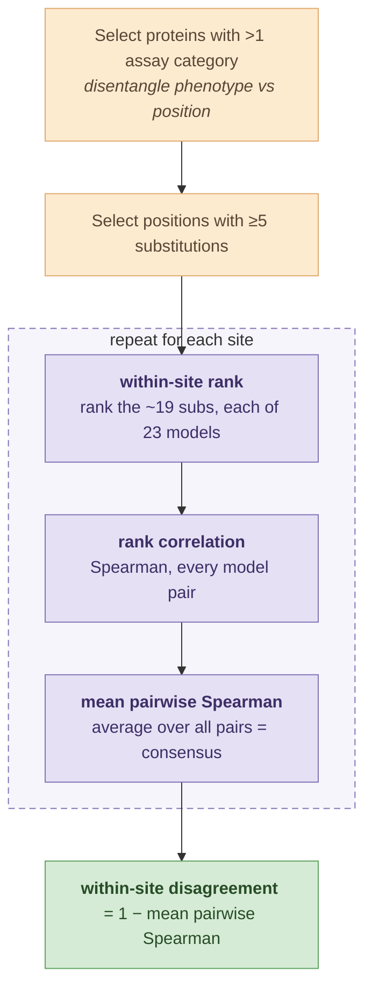

# ProteinGym v1 — model predictions analyzed *by position*

Scripts, results, and findings for a by-position study of the ProteinGym v1
zero-shot substitution models: how per-model performance varies by **taxon** and
**model_type**, how models rank mutations **within a site**, where they
**disagree**, and whether that disagreement tracks functional/structural context.
Deep-dive protein: **HXK4_HUMAN** (glucokinase / GCK).

Data (not tracked in this repo): 217 DMS substitution assays in
`../O2/20250613/*.csv`, 97 models (columns `Site_Independent … Protriever`),
metadata `../ProteinGym/reference_files/DMS_substitutions.csv`, config
`../ProteinGym/config.json`. UniProt entries for the multi-assay proteins are
cached in `data/uniprot/raw_json/` (raw entries; fetched by scripts 08/15). Derived
UniProt annotation tables live in `data/uniprot/additional_annotations/`: GoF-supplement
tables (script `24`) and per-protein structural/functional annotations — binding
residues per ligand, subdomains, disordered regions, disease variants (script `25`,
mirrors what `23` overlays). Allosteric-site atlases parsed from primary papers are in
`results/allosteric_map/` (script `26`; SRC_HUMAN first).
Structure files (used by the 3-D scripts `17`–`20`) live in `data/structures/pdb/`
(crystal PDBs 1V4S, 3VEV) and `data/structures/af2/` (AlphaFold model HXK4_HUMAN).

**ClinVar disease variants** for **10 human multi-assay proteins** are in
`data/clinvar/*.tsv` (GCK, PTEN, TP53, SRC, CYP2C9, KCNE1, CARD11, VKORC1, KRAS,
NPC1) and drive the disease annotation on those proteins' structure maps (`23`);
HLA-A and SLC22A1 have no qualifying entry, and non-human proteins keep the UniProt
flag. **Download recipe and the per-protein review-status filters are documented in
`data/clinvar/README.md`** (base query: ClinVar, 28 Aug 2026, gene symbol, Germline
= Pathogenic + Likely pathogenic, missense, single-nucleotide; review-status filter
varies by protein). Script `23` parses the position from the canonical `p.(Xxx###Yyy)`
change in the `Name` column and keeps only variants whose wild-type matches our
assay-isoform sequence (drops splice-isoform mismatches, e.g. KRAS D153V on KRAS4A).
Because ClinVar pathogenic queries are LoF-dominated, `23` also **supplements** every
ClinVar set with UniProt natural-variant positions whose disease description carries
gain-of-function language (the full `GOF_KW` keyword list is in `data/clinvar/README.md`;
matches: GCK 7, CARD11 2, KRAS 7, others 0). GCK is the clearest case: its ClinVar
query targets **diabetes** (MODY/PNDM, LoF) and cannot contain the hyperinsulinism
**gain-of-function** variants (e.g. W99C/HHF3 — W99's only ClinVar entry is the
non-missense Trp99Ter, a single submitter), so the supplement adds the UniProt
hyperinsulinism/HHF positions (65, 91, 99, 214, 442, 455, 456), giving **129** GCK
disease positions total. This is far
cleaner than the old UniProt keyword flag (**411** positions — heavily
over-inclusive, catching benign/VUS natural variants): 123 curated ClinVar P/LP +
6 GoF, vs 411. So R377 (MODY2, LoF) comes from ClinVar and W99C (HHF3, GoF) from
the supplement — both retain their `dz` tag.

Requires `pandas, numpy, scipy, matplotlib, seaborn` (plus `biopython` for the
3-D analysis `17`). Figures are **not** tracked (regenerable); see `.gitignore`.

## Study design: pairing assays on one protein
**Overlapping coordinates + different selection types = a controlled comparison.**
When the same protein (same `UniProt_ID`, and we verified the same `target_seq` so
positions are truly comparable) is measured by assays of different
`coarse_selection_type` — e.g. abundance/Expression vs activity vs binding — you have
the same mutations at the same residues scored under different phenotypes. That holds
everything constant except the measured axis of fitness. This design separates two
things that are otherwise confounded when a model predicts a DMS poorly:

1. **Is the model wrong, or measuring a different phenotype than the assay?** A model
   that ranks substitutions by, say, stability will track an abundance assay but not
   necessarily an activity assay at the same site. Paired assays let you attribute
   disagreement to phenotype-specificity rather than model error.
2. **Is a "hard"/high-disagreement site intrinsic to the position, or phenotype-
   dependent?** If models disagree at a site in *both* the activity and abundance
   assays, the position itself is intrinsically ambiguous; if only in one, the
   difficulty is phenotype-driven.

## Directionality (read first)
`config.json` lists a per-model `directionality` (+1 = higher score ⇒ higher
fitness; −1 ⇒ lower). **The score columns in `O2/20250613/*.csv` are already
oriented so higher = fitter for every model** — verified in `00`: all 8
`directionality=−1` models correlate *positively* with `DMS_score` (EVE +0.46,
RSALOR +0.48, DeepSequence +0.44…). So we never re-apply directionality, matching
ProteinGym's own `performance_DMS_benchmarks.py`.

## Model subsets used
Two curated subsets exist for different jobs: the **45 family-best** set
deduplicates the 97 so redundant same-family variants don't inflate agreement
statistics (used wherever we pool over many models), while the **23-model
subset** is a smaller hand-picked representative panel meant to be *read* in a
single figure (per-model bars, labelled heatmaps) without 97 rows of clutter.
They are not nested and use slightly different `model_type` labels, so numbers
are only comparable within the same subset.
- **97 models** — full config list (analyses 01–03).
- **45 family-best** (`05`) — one model per family (parameter-size / single-vs-
  ensemble variants collapsed), keeping the highest overall-Spearman member.
  Used for disagreement work (06, 08, 11, 15, 16).
- **23-model subset** (`04`) — a hand-curated representative set (user-supplied
  `model_dict`, with its own `model_type` labels). Used for within-site
  Spearman-vs-experiment work (09, 12, 13, 14).

## How to run
```bash
cd scripts
python3 00_check_directionality.py            # directionality verification
python3 01_compute_spearman.py                # per-assay Spearman -> spearman_long.csv
python3 02_spearman_by_taxa.py                # taxa / model_type + figs 1-4
python3 03_persite_ranking.py                 # within-site agreement matrices + figs 5-8
python3 04_subset_figs.py                     # Fig5_subset + Fig6 by selection_type (23 models)
python3 05_fig6_familybest.py                 # Fig6 from 45 family-best models
python3 06_hxk4_site_disagreement.py          # HXK4 per-site disagreement + overview figs
python3 07_w99_deepdive.py                    # W99 rankings (45-model view)
python3 08_gck_structure_map.py               # disagreement vs GCK functional map (UniProt)
python3 09_w99_subset_figs.py                 # W99 rankings + per-model-vs-DMS stat (23 models)
python3 10_assay_overlap.py                   # multi-assay proteins sharing coordinates
python3 11_hxk4_lowagreement_batch.py         # 06/09 batched over all low-agreement HXK4 sites
python3 12_abundance_physchem.py              # abundance vs hydrophobicity + charge
python3 13_agreement_vs_accuracy.py           # among-model agreement vs accuracy-vs-experiment
python3 14_quartile_by_agreement.py           # 'winners' collapse, high- vs low-agreement sites
python3 15_functional_disagreement_generalization.py   # generalization across multi-assay proteins
python3 16_collapse_modeltype_withinsite.py   # collapse by model_type; global vs within-site split
python3 17_gck_3d_distances.py                # GCK disagreement vs 3-D ligand distance (PDB 1V4S)
python3 18_compare_3vev_1v4s.py               # GCK 3-D robustness: AF model vs 1V4S (superpose + ligand transfer)
python3 19_gck_3d_view.py                     # GCK 3-D view coloured by disagreement + B-factor PDB export
python3 20_native_3vev_vs_1v4s.py             # GCK 3-D robustness: 1V4S vs 3VEV, each with native ligands
python3 21_generalization_candidates.py       # multi-assay candidate proteins + RCSB PDB options
python3 22_disease_gof_lof.py                 # GoF vs LoF disease-variant systematic check
python3 23_structure_maps_all.py              # per-protein disagreement structure maps (all multi-assay proteins)
python3 24_gof_supplement_tables.py           # write UniProt GoF-supplement tables -> data/uniprot/additional_annotations/
python3 25_export_structural_annotations.py   # per-protein binding/subdomain/disorder/disease annotations (md+csv)
python3 26_src_allosteric_sites.py            # parse SRC allosteric sites from Beltran 2026 -> results/allosteric_map/SRC_HUMAN.tsv
python3 27_export_high_disagreement_sites.py  # per-protein tables of 23's labelled high-disagreement sites
```
Planned analyses are tracked in `NEXT_STEPS.md`.

## Reproduce
`make all` runs scripts `00 → 27` in order (each reads the previous ones'
`results/`), regenerating every CSV and figure and logging timestamps + output to
`RUN.log`. This is how to confirm the numbers quoted below stay in sync with the
code. Requires the `data/` UniProt cache (tracked) for `08`/`15`; no network
needed. `make clean` removes generated `results/`/`figures/` (leaves `data/`).

## Within-site disagreement — how it's computed
Scores are used as-is (already higher = fitter). Steps:
1. **Select proteins** with >1 assay category (the controlled comparison above).
2. **Select positions** ("sites") with ≥5 substitutions.
3. For each site: **within-site rank** each model's scores over the ~19
   substitutions (per model, over the 23-model subset).
4. **Rank correlation** — Spearman between every pair of models' within-site rankings.
5. **Mean pairwise Spearman** — average over all model pairs = the consensus/agreement.
6. **within-site disagreement = 1 − mean pairwise Spearman** (high = models disagree).


Legend: 🟧 inputs / prep · 🟪 per-site computation · 🟩 result. (The green box is
labelled *disagreement* — matching the code and the rest of this README — i.e.
`1 − mean pairwise Spearman`; the paired quantity *agreement* is the mean itself.)
A static vector export of this diagram is produced by
`scripts/render_within_site_flow.py` → `figures/within_site_disagreement_flow.pdf`.

**Two thresholds worth remembering:** the **≥5 substitutions per site** cutoff is
used in the HXK4 analysis (`06`) and the per-protein maps (`23`); the assay-level
agreement matrices in `03` use **≥3** instead, and then pool across sites and
**Fisher-z average across assays**.

## Key findings

**Taxon & model_type (02).** Pooled over models, mean Spearman is similar for
Human (0.42) / Eukaryote (0.43) / Prokaryote (0.41) but lower for **Virus
(0.35)**; 38/97 models show a significant taxon effect (BH q<0.05), the most
taxon-sensitive being small sequence-only models. Model-type ranking is stable:
Structure&MSA (0.51) > ESM3/Function (0.48) ≈ Single-seq&Structure (0.46) >
MSA (0.44) > Structure (0.37) > Single-sequence (0.36).

**Within-site ranking agreement (03–05).** Models agree far less on *within-site*
rankings than on overall scores. Types cluster: MSA↔Structure&MSA agree most
(0.70–0.73); pure **Structure** models are the outliers (≈0.37–0.44 with
sequence/MSA types). Recovering the experiment's within-site order is hard (best
model ≈0.35): best are structure-aware+context models (AIDO.Protein-RAG,
VenusREM, ProSST-2048, ESM3, S3F); worst are autoregressive single-sequence LMs.

**HXK4 per-site disagreement (06–07, 11).** Sites where models most disagree on
within-site ranking overlap heavily between the two GCK assays (17/20 of the
top-20 shared) → disagreement is a property of the *position*, not the phenotype.
Pure **Structure** models are the biggest dissenters. Curated low-agreement
sites: T49, R63, W99, H156, Y214, Q287, R345, Y349, R377, V401, M402 (terminal
tails L2/D4/R5/L460–463 excluded).

**Functional context on GCK (08, 17).** In 1-D, disagreement is significantly
**higher at binding-site residues** than elsewhere (activity p=0.005, abundance
p=0.018). But in real 3-D (PDB 1V4S, glucose + activator; `17`) high-disagreement
residues are **not** closer to the ligand pockets (Spearman −0.04 to −0.08, n.s.)
and **not** spatially clustered (permutation p≈0.66–0.88) — so the 1-D "binding-site"
signal reflects sequence-annotation overlap, not a physical pocket neighbourhood.
A *subset* of hotspots does line the pockets, though — **R63** (2.7 Å) and **Y214**
(3.0 Å) contact the allosteric activator and **Q287** (3.5 Å) contacts glucose —
which is what drove the 1-D annotation signal. Structure choice is immaterial:
1V4S vs 3VEV (each with its own native ligands) give per-residue nearest-ligand
distances at Pearson 0.996 (`18`/`20`); 1V4S is used for the published-literature
convention and to avoid 3VEV's N-terminal construct/isoform mismatch (res 4–11).

**Multi-assay coordinate overlap (10).** Of 186 proteins, 24 have ≥2 assays; **23
have ≥1 assay pair sharing mutated residues** (all on one identical `target_seq`).
Exception: F7YBW8_MESOW. P53_HUMAN_Kotler_2018 dropped (different `target_seq`).
Many pairs deliberately span selection types (abundance vs activity vs binding).

**Can model performance be explained by residue hydrophobicity + net charge? (12,
HXK4 abundance assay).** Approach: test whether the models' per-model rank
correlation is "just" recapitulating Δhydrophobicity and Δnet-charge by (1) building
a features-only baseline and (2) checking how much each model's correlation survives
after controlling for those two features (partial correlation). **Short answer: no —
they explain only a small slice.** The abundance assay does have a physicochemical
component, but weak: over all 8,396 single mutants, Δhydrophobicity (Kyte-Doolittle)
correlates with the score at Spearman **+0.19** (more hydrophobic ⇒ higher
abundance/stability) and losing hydrophobicity `|d_hydro|` at **−0.15**; net-charge
terms are essentially flat (`d_charge` −0.06, `|d_charge|` −0.01). A combined
features-only OLS baseline reaches **Spearman 0.22, R² = 0.08**. Models clearly beat
that and keep almost all of it after control: every model except ProteinMPNN
out-predicts the baseline (raw Spearman 0.32–0.42; SaProt_650M_AF2 tops at 0.42), and
partialling out hydrophobicity + charge barely dents performance (**mean raw 0.366 →
partial 0.319**, i.e. only **~13%** attributable to these two properties — models
retain ~87%). And "more physicochemical" ≠ "better": how much of a model's own score
is explained by hydro+charge (R²) does **not** track performance — the two most
physicochemical models (ProSST-2048 R²=0.25, VenusREM R²=0.21) sit mid-pack, while
top performers SaProt and ESM3 (R²=0.08) are among the *least* physicochemical.
*Caveats:* this is the whole-assay (across-position) signal dominated by burial/
context — within a single site (wild-type fixed) these features explain even less;
a nonlinear control or adding volume/polarity would explain marginally more but not
change the conclusion; charge assigned at physiological pH (D,E −1; K,R +1; H +0.1),
and the near-zero charge result is robust to dropping the His partial charge.
Outputs: `abundance_physchem_model_table.csv`, `fig_abundance_physchem.png`.

**Consensus predicts accuracy (13).** Among-model agreement at a site positively
predicts model-vs-experiment accuracy (Spearman 0.25 activity / 0.38 abundance);
accuracy roughly doubles from low- to high-agreement sites — but with a hard
ceiling (~0.3–0.4) and much scatter, so consensus is a useful, imperfect
confidence signal.

**"Winners" collapse (14, 16).** Model ranking-vs-experiment collapses to ~0 on
the top fitness quartile (the classic "poor prioritizer of winners"), in **both**
high- and low-agreement sites — agreement doesn't rescue it. Structure-only
models do **not** collapse worse (slightly better on the activity tail).
Redefining "winners" as best-substitution-*within-site* rather than
globally-most-fit roughly quadruples retained signal (top-25% ≈0.12–0.38),
showing the collapse is largely an artifact of the global definition mixing in
across-position signal.

**Generalization of the disagreement→function link (15).** Across all multi-assay
proteins, only the binding-site part generalizes: disagreement is elevated near
**binding/active-site residues** in 10/13 proteins (pooled p=5×10⁻¹³). The
**disease-variant** and **disordered-region** patterns do **not** generalize
(disordered regions trend the *opposite* way — lower disagreement — in P53 and
HSP82). Disease-annotation saturation (HXK4 412/465, P53 333/393 positions) makes
a combined "functional" flag misleading; the three signals must be tested apart.

**Disease-mutation anecdotes (from UniProt P35557).** W99 → **W99C / HHF3**
(gain-of-function, activating) — the assay agrees (W99 is an activating position),
but conservation-based models rank it backwards. R377 → **R377H / MODY2**
(loss-of-function) — non-functional in both assays.

**GoF vs LoF disease variants, systematic (22).** Extending those anecdotes to 204
classified disease variants (benign/likely-benign/uncertain-significance variants
lacking any functional-effect annotation are dropped; GoF = GCK-HHF3 + RASK; LoF =
GCK-MODY2/PNDM1 + PTEN + KCNE1 + CP2C9; SRC contributed none), the W99C pattern
does **not** generalize.
Models rank GoF variants *higher* within-site (median 0.83, only 12% in the bottom
half) than LoF (0.67, 33% bottom half) — the **opposite** of "predict GoF as
deleterious" (Mann-Whitney GoF<LoF p=1.0); the within-GCK contrast reproduces it
(HHF3 0.89 vs MODY2 0.67), with W99C (0.11) a rare conserved-Trp exception.
Corrected reading: conservation/fitness models **under-flag pathogenic variants of
both classes** (a majority sit in the tolerated top-half) and are *most* blind to
GoF — a GoF variant preserves/enhances molecular function, so it looks like an
acceptable substitution. The DMS assays behave the same way (GoF 0.67 vs LoF 0.50
median), so neither models nor these molecular assays capture dosage/physiological
GoF pathogenicity.

## External claims we checked
Two claims from *"Overestimating zero-shot fitness prediction"*
(`../../Papers/interesting papers/overestimating_zeroshot_fitness_prediction.pdf`):

**Claim 1 — "In every multi-phenotype study, one phenotype is just abundance, so
apparent function prediction is often really stability/expression prediction."
→ Overstated; directionally true, not "every."** Of the 24 multi-assay proteins, 14
are genuinely multi-*phenotype* (>1 distinct `coarse_selection_type`; the other 10
are same-type replicates, e.g. BLAT_ECOLX's four OrganismalFitness assays). Of those
14, **11/14 (79%) include an Expression/abundance arm**, but **3 do not have any
Expression or Stability phenotype**, directly falsifying "every": CCDB_ECOLI (Activity
+ OrganismalFitness), RL40A_YEAST (OrganismalFitness ×2 + Activity), SRC_HUMAN
(Activity ×2 + OrganismalFitness). Also, most of the 217 assays are single-phenotype,
so most "function" benchmarks aren't paired with an abundance control at all. Defensible
version: *"when ProteinGym pairs phenotypes on one protein, ~80% of the time one arm is
an abundance/expression readout"* — not "every study."

**Claim 2 — "Models can't rank function-enhancing mutations; ρ collapses on the
highly-fit subset (models are good filters of deleterious variants, poor prioritizers
of winners)." → Strongly true as a phenomenon; the cytochrome example essentially
reproduces.** The only cytochrome in the set is CP2C9; ESM3 on it collapses from
overall ρ **0.70/0.66** (activity/abundance) → top-25% **0.13/0.10** → top-10%
**≈−0.03**, landing on the paper's "≈0.10 on highly-fit." It generalises across all
209 assays (≥200 single mutants): mean overall → top-25% → top-10% ρ is ESM3
0.49→0.04→−0.01, GEMME 0.45→−0.02→−0.04, ESM1v_ensemble 0.41→0.01→−0.02,
SaProt 0.46→0.02→−0.01 — ranking power essentially vanishes in the top fitness
quartile. *Caveat:* restricting to a narrow high-fitness band mechanically attenuates
ρ (range restriction), so read the tail values as "≈0" and the *comparison* as the
signal, not a claim that models are uniquely bad versus that ceiling. See also our
within-site "winners" analysis (`14`, `16`): the collapse is far gentler when
"winners" are defined *within-site* (best substitution per position) rather than
globally-most-fit.

## Caveats (carried across analyses)
- **Range restriction** attenuates every quartile/tail Spearman; read absolute
  tail values as "≈0", trust the *comparisons* (between splits, groups, types).
- **"Winners" within-site metric is pooled across sites**, so it reintroduces
  across-position ranking — an easier question than global gain-of-function.
- **`Structure` = only 3 models** in the family-best set (ESM-IF1, MIF,
  ProteinMPNN); those lines are noisy.
- **"Near binding" is sequence-proximity ±2**, not 3D contact.
- **Disease/disordered generalization** rests on few proteins (3 and 5) and on
  UniProt annotations; GCK's "disordered" T49/R63 were user-asserted, not
  UniProt-annotated (GCK has no UniProt disordered region).
- Per-site disagreement uses sites with **≥5 substitutions** (06/11; ≥3 in 03).
- **"Disagreement at functional sites" is an annotation-level, not a structural,
  claim.** The 1-D binding-site enrichment (08, p=0.005/0.018) does **not** survive
  in 3-D (`17`): high-disagreement residues are neither closer to the glucose/
  activator pockets (Spearman −0.04 to −0.08, n.s.) nor spatially clustered
  (permutation p≈0.66–0.88). So the signal reflects overlap with UniProt
  binding-site *annotations*, not a physical pocket neighbourhood — interpret the
  functional-site result cautiously and, where a structure exists, prefer a real
  3-D distance test. (A few hotspots — R63, Y214, Q287 — do contact a ligand,
  which is what the annotation test picks up.) The 3-D result is robust to
  structure choice: 1V4S vs 3VEV give per-residue distances at Pearson 0.996
  (`18`/`20`).
- **Candidate-protein `best_pdb` (21) optimizes coverage then resolution;
  `best_holo_pdb` is the ligand-aware pick.** `best_pdb` is blind to ligands, so
  for a ligand-distance analysis like `17` use `best_holo_pdb` / `best_holo_ligands`
  (e.g. GCK → 4DCH with GLC+4DC; RASK → 7ROV/GCP; CP2C9 → 1R9O/HEM+FLP; DYR →
  8UW0/FOL+NAP). Holo status comes from RCSB nonpolymer components (cached in
  `data/pdb_ligands_cache.json`) filtered by an additive/ion blacklist + mass ≥130
  Da — a **heuristic**, so verify the reported `best_holo_ligands` comp IDs, and
  note a blank `best_holo_pdb` only means "no holo among the top-40 by coverage".
- **GoF/LoF check (22) uses a RELATIVE, protein-level classification.** Within-site
  percentile ranks a variant among substitutions at its site, not absolute
  deleteriousness — noisy at fully-conserved positions (e.g. RAS G12). GoF/LoF is
  assigned by disease phenotype at the protein level (RAS/SRC oncogene = GoF, PTEN/
  KCNE1/CP2C9 = LoF, GCK bidirectional), so the cross-protein contrast is confounded
  by protein identity — but the within-GCK contrast reproduces it. RAS assays measure
  abundance/binding (not GTPase activity), so the DMS can't validate RAS GoF direction.
- **`MSA_Neff_L` is not good for some assays — both extremes hurt MSA-dependent
  models.** Effective MSA depth per length varies enormously across the 217 assays
  (median 30.5, range 0 → 12,395). **Too shallow** (36/217 are `Low` /
  `MSA_Neff_L < 1`, e.g. CAR11 0.04, P53 0.39, viral RBDs ≈1): the alignment
  carries little position-specific signal, so MSA-based models (EVmutation, EVE,
  GEMME, MSA-Transformer) and Structure&MSA models are starved of information.
  **Too deep** (Neff_L in the thousands): very large/over-diverse alignments can
  fold in distant homologs and paralogs that dilute the couplings for *this*
  sequence, again degrading specificity — so the depth→MSA-model-quality relation
  is non-monotonic, best at an intermediate depth. Either way, any **model_type
  comparison involving MSA-dependent types is confounded by MSA depth** (02, 03,
  05, 15, 16) — check per-assay `MSA_Neff_L` (both tails) before attributing an
  MSA-model score to the model. Relevant low-Neff multi-assay proteins in `10`:
  CAR11 0.04, P53 0.39, NPC1 0.67, SPIKE 1.06.

## Outputs (`results/`)
Per-assay & taxa: `directionality_check.csv`, `spearman_long.csv`,
`spearman_model_by_taxon.csv`, `spearman_modeltype_by_taxon.csv`,
`kruskal_{model,modeltype}_across_taxa.csv`.
Within-site agreement: `persite_model_agreement_matrix.csv`,
`persite_modeltype_agreement_matrix.csv`, `persite_dms_agreement_*.csv`,
`persite_modeltype_agreement_by_selectiontype*.csv`, `family_best_selection.csv`.
HXK4 site work: `hxk4_*_site_disagreement.csv`, `site_W99_*_rank_matrix.csv`,
`gck_site_functional_annotation_*.csv`, `gck_disagreement_vs_function_summary.csv`,
`gck_3d_residue_distances.csv`, `gck_3d_summary.csv`,
`disease_gof_lof_variants.csv`, `disease_gof_lof_summary.csv`.
Overlap: `assay_position_overlap_{proteins,pairs,selected_assays}.csv`.
Physchem / accuracy / collapse: `abundance_physchem_model_table.csv`,
`hxk4_agreement_vs_accuracy_*.csv`, `hxk4_quartile_by_agreement*.csv`,
`collapse_modeltype_withinsite.csv`.
Allosteric maps: `allosteric_map/SRC_HUMAN.tsv` (per-residue Src allosteric-site
atlas parsed from Beltran 2026 — site class, inhibitory/activating direction,
region, druggable pocket, evidence; `26`).
Generalization: `generalization_functional_disagreement_{sites,per_protein}.csv`,
`generalization_candidate_proteins.csv` (24 multi-assay proteins + RCSB PDB
options, for choosing a protein/structure to extend the analysis — `21`; includes
`conformational_switch`, `literature_pdb`, `recommended_pdb` per the structure-
selection framework in `papers/pdb_selection_framework.md`).

Figures (regenerable, not tracked) land in `figures/`, with the HXK4 low-agreement
batch under `figures/site_disagreement/HXK4_HUMAN/` and the per-protein disagreement
structure maps (`23`, one `fig_<gene>_structure_map.png` per multi-assay protein)
under `figures/site_disagreement/`. The exact labelled high-disagreement sites behind
those maps are tabulated per protein (`27`) under
`figures/site_disagreement/high_disagreement_sites/`.

## Version control
Repo scoped to `analysis/` only; remote
`https://github.com/ElainW/PG1_additional_analysis.git`. Figures and large
glucokinase media assets (`*.gif/*.mp4/*.pse`) are git-ignored.
