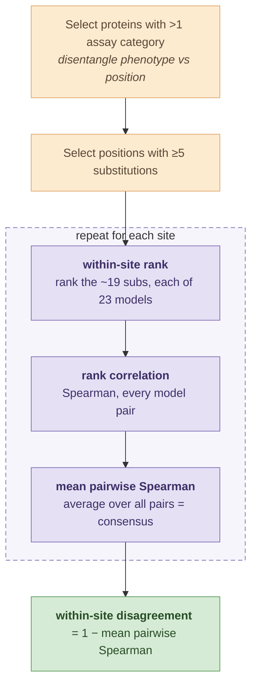

# ProteinGym v1 — model predictions analyzed *by position*

Scripts, results, and findings for a by-position study of the ProteinGym v1
zero-shot substitution models: how per-model performance varies by **taxon** and
**model_type**, how models rank mutations **within a site**, where they
**disagree**, and whether that disagreement tracks functional/structural context.
Deep-dive protein: **HXK4_HUMAN** (glucokinase / GCK).

Data (not tracked in this repo): 217 DMS substitution assays in
`../O2/20250613/*.csv`, 97 models (columns `Site_Independent … Protriever`),
metadata `../ProteinGym/reference_files/DMS_substitutions.csv`, config
`../ProteinGym/config.json`. The reference-metadata table (per-assay
`UniProt_ID`, `coarse_selection_type`, and MSA depth `MSA_Neff_L` /
`MSA_Neff_L_category`) lives at, relative to this `analysis/` dir,
`../ProteinGym/reference_files/DMS_substitutions.csv`
(absolute: `/Users/yilanwang/Desktop/MarksLab/PG2/ProteinGym/reference_files/DMS_substitutions.csv`);
in scripts it is `common.REF_PATH`. UniProt entries for the multi-assay proteins are
cached in `data/uniprot/raw_json/` (raw entries; fetched by scripts 08/15). Derived
UniProt annotation tables live in `data/uniprot/additional_annotations/`: GoF-supplement
tables (script `24`) and per-protein structural/functional annotations — binding
residues per ligand, subdomains, disordered regions, disease variants (script `25`,
mirrors what `23` overlays). Allosteric-site atlases parsed from primary papers are in
`results/allosteric_map/` (SRC_HUMAN from script `26`, RASK_HUMAN/KRAS from `47`).
Structure files (used by the 3-D scripts `17`–`20`) live in `data/structures/pdb/`
(crystal PDBs 1V4S, 3VEV) and `data/structures/af2/` (AlphaFold model HXK4_HUMAN).

**ClinVar disease variants** for **10 human multi-assay proteins** are in
`data/clinvar/*.tsv` (GCK, PTEN, TP53, SRC, CYP2C9, KCNE1, CARD11, VKORC1, KRAS,
NPC1) and drive the disease annotation on those proteins' structure maps (`23`);
HLA-A and SLC22A1 have no qualifying entry, and non-human proteins keep the UniProt
flag. **Download recipe and the per-protein review-status filters are documented in
`data/clinvar/README.md`** (base query: ClinVar, 28 Aug 2026, gene symbol, Germline
= Pathogenic + Likely pathogenic, missense, single-nucleotide; review-status filter
varies by protein). Script `23` parses the position from the canonical `p.(Xxx###Yyy)`
change in the `Name` column and keeps only variants whose wild-type matches our
assay-isoform sequence (drops splice-isoform mismatches, e.g. KRAS D153V on KRAS4A).
Because ClinVar pathogenic queries are LoF-dominated, `23` also **supplements** every
ClinVar set with UniProt natural-variant positions whose disease description carries
gain-of-function language (the full `GOF_KW` keyword list is in `data/clinvar/README.md`;
matches: GCK 7, CARD11 2, KRAS 7, others 0). GCK is the clearest case: its ClinVar
query targets **diabetes** (MODY/PNDM, LoF) and cannot contain the hyperinsulinism
**gain-of-function** variants (e.g. W99C/HHF3 — W99's only ClinVar entry is the
non-missense Trp99Ter, a single submitter), so the supplement adds the UniProt
hyperinsulinism/HHF positions (65, 91, 99, 214, 442, 455, 456), giving **129** GCK
disease positions total. This is far
cleaner than the old UniProt keyword flag (**411** positions — heavily
over-inclusive, catching benign/VUS natural variants): 123 curated ClinVar P/LP +
6 GoF, vs 411. So R377 (MODY2, LoF) comes from ClinVar and W99C (HHF3, GoF) from
the supplement — both retain their `dz` tag.

Requires `pandas, numpy, scipy, matplotlib, seaborn` (plus `biopython` for the
3-D analysis `17`). Figures are **not** tracked (regenerable); see `.gitignore`.

## Study design: pairing assays on one protein
**Overlapping coordinates + different selection types = a controlled comparison.**
When the same protein (same `UniProt_ID`, and we verified the same `target_seq` so
positions are truly comparable) is measured by assays of different
`coarse_selection_type` — e.g. abundance/Expression vs activity vs binding — you have
the same mutations at the same residues scored under different phenotypes. That holds
everything constant except the measured axis of fitness. This design separates two
things that are otherwise confounded when a model predicts a DMS poorly:

1. **Is the model wrong, or measuring a different phenotype than the assay?** A model
   that ranks substitutions by, say, stability will track an abundance assay but not
   necessarily an activity assay at the same site. Paired assays let you attribute
   disagreement to phenotype-specificity rather than model error.
2. **Is a "hard"/high-disagreement site intrinsic to the position, or phenotype-
   dependent?** If models disagree at a site in *both* the activity and abundance
   assays, the position itself is intrinsically ambiguous; if only in one, the
   difficulty is phenotype-driven.

## Directionality (read first)
`config.json` lists a per-model `directionality` (+1 = higher score ⇒ higher
fitness; −1 ⇒ lower). **The score columns in `O2/20250613/*.csv` are already
oriented so higher = fitter for every model** — verified in `00`: all 8
`directionality=−1` models correlate *positively* with `DMS_score` (EVE +0.46,
RSALOR +0.48, DeepSequence +0.44…). So we never re-apply directionality, matching
ProteinGym's own `performance_DMS_benchmarks.py`.

## Model subsets used
Two curated subsets exist for different jobs: the **45 family-best** set
deduplicates the 97 so redundant same-family variants don't inflate agreement
statistics (used wherever we pool over many models), while the **23-model
subset** is a smaller hand-picked representative panel meant to be *read* in a
single figure (per-model bars, labelled heatmaps) without 97 rows of clutter.
They are not nested and use slightly different `model_type` labels, so numbers
are only comparable within the same subset.
- **97 models** — full config list (analyses 01–03).
- **45 family-best** (`05`) — one model per family (parameter-size / single-vs-
  ensemble variants collapsed), keeping the highest overall-Spearman member.
  Used for disagreement work (06, 08, 11, 15, 16).
- **23-model subset** (`04`) — a hand-curated representative set (user-supplied
  `model_dict`, with its own `model_type` labels). Used for within-site
  Spearman-vs-experiment work (09, 12, 13, 14).

## How to run
```bash
cd scripts
python3 00_check_directionality.py            # directionality verification
python3 01_compute_spearman.py                # per-assay Spearman -> spearman_long.csv
python3 02_spearman_by_taxa.py                # taxa / model_type + figs 1-4
python3 03_persite_ranking.py                 # within-site agreement matrices + figs 5-8
python3 04_subset_figs.py                     # Fig5_subset + Fig6 by selection_type (23 models)
python3 05_fig6_familybest.py                 # Fig6 from 45 family-best models
python3 06_hxk4_site_disagreement.py          # HXK4 per-site disagreement + overview figs
python3 07_w99_deepdive.py                    # W99 rankings (45-model view)
python3 08_gck_structure_map.py               # disagreement vs GCK functional map (UniProt)
python3 09_w99_subset_figs.py                 # W99 rankings + per-model-vs-DMS stat (23 models)
python3 10_assay_overlap.py                   # multi-assay proteins sharing coordinates
python3 11_hxk4_lowagreement_batch.py         # 06/09 batched over all low-agreement HXK4 sites
python3 12_abundance_physchem.py              # abundance vs hydrophobicity + charge
python3 13_agreement_vs_accuracy.py           # among-model agreement vs accuracy-vs-experiment
python3 14_quartile_by_agreement.py           # 'winners' collapse, high- vs low-agreement sites
python3 15_functional_disagreement_generalization.py   # generalization across multi-assay proteins
python3 16_collapse_modeltype_withinsite.py   # collapse by model_type; global vs within-site split
python3 17_gck_3d_distances.py                # GCK disagreement vs 3-D ligand distance (PDB 1V4S)
python3 18_compare_3vev_1v4s.py               # GCK 3-D robustness: AF model vs 1V4S (superpose + ligand transfer)
python3 19_gck_3d_view.py                     # GCK 3-D view coloured by disagreement + B-factor PDB export
python3 20_native_3vev_vs_1v4s.py             # GCK 3-D robustness: 1V4S vs 3VEV, each with native ligands
python3 21_generalization_candidates.py       # multi-assay candidate proteins + RCSB PDB options
python3 22_disease_gof_lof.py                 # GoF vs LoF disease-variant systematic check
python3 23_structure_maps_all.py              # per-protein disagreement structure maps (all multi-assay proteins)
python3 24_gof_supplement_tables.py           # write UniProt GoF-supplement tables -> data/uniprot/additional_annotations/
python3 25_export_structural_annotations.py   # per-protein binding/subdomain/disorder/disease annotations (md+csv)
python3 26_src_allosteric_sites.py            # parse SRC allosteric sites from Beltran 2026 -> results/allosteric_map/SRC_HUMAN.tsv
python3 27_export_high_disagreement_sites.py  # per-protein tables of 23's labelled high-disagreement sites
python3 28_msa_conservation.py                # per-column MSA conservation vs disagreement -> results/MSA_conservation/
python3 29_family_best_category_analysis.py   # per-category leaderboard (Spearman + NDCG@10) + high/low-disagreement rank-vs-accuracy (fig9)
python3 30_export_low_disagreement_sites.py   # per-protein tables of low-disagreement sites (mirror of 27)
python3 31_disagreement_distributions.py      # per-UniProt disagreement distribution plots -> figures/site_disagreement/distribution/

python3 32_high_disagreement_colocalization.py # do a protein's high-disagreement sites recur across its assays? permutation test (add 'low' arg for control tail)
python3 33_colocalization_forest.py           # forest plot of 32's per-assay observed-vs-null overlap ('low' arg for control tail)
python3 34_conservation_disagreement_mechanism.py # H1 (DMS-spread) + H2 (model-class) mechanism tests -> results/MSA_conservation/{H1,H2}/
python3 35_conservation_histograms.py         # H1 per-category conservation tables for P53/PTEN/GCK -> H1/H1_conservation_by_category.csv
python3 35_conservation_density_plots.py      # H1 per-category conservation tables for CYP2C9 -> H1/H1_conservation_by_category_cyp2c9.csv
python3 37_conservation_dms_panels.py         # per-assay 2x2 conservation+DMS density panels (PTEN/CP2C9/HXK4/P53)
python3 38_h2_lowcons_persite_spearman_density.py  # H2 table: per-site Spearman at shared high-disagreement LOW-conservation sites
python3 39_h2_shared_strip_panel.py           # box+strip panel of 38 (PTEN|HXK4|CP2C9)
python3 40_h2_highcons_shared_strip_panel.py  # H2 high-conservation counterpart table+panel (P53|HXK4)
python3 41_assayspecific_category_best.py     # assay-SPECIFIC hard sites: does category-tuned model choice help? (3 figs + picks)
python3 42_assayspecific_best_model_per_assay.py   # single best family-best model per assay at its assay-specific hard sites
python3 43_assayspecific_rank_tiers.py        # top / rank-23 / lowest within-site model at assay-specific hard sites
python3 44_persite_category_leaderboard.py    # per-site Spearman leaderboard over 217 assays x 45 models + category tier plot
python3 45_p53_highcons_classwise.py          # P53 disagree-at-conserved: seq/MSA vs structure-based per-site Spearman by class
python3 46_persite_vs_global_spearman.py      # per-site (weighted) vs overall Spearman + curve fit (--recompute to rebuild the ~8min long table)
python3 47_kras_allosteric_sites.py           # curate KRAS allosteric sites from Weng 2023 -> results/allosteric_map/RASK_HUMAN.tsv
```
Planned analyses are tracked in `NEXT_STEPS.md`.

## Reproduce
`make all` runs scripts `00 → 27` in order (each reads the previous ones'
`results/`), regenerating every CSV and figure and logging timestamps + output to
`RUN.log`. This is how to confirm the numbers quoted below stay in sync with the
code. Requires the `data/` UniProt cache (tracked) for `08`/`15`; no network
needed. `make clean` removes generated `results/`/`figures/` (leaves `data/`).

## Within-site disagreement — how it's computed
Scores are used as-is (already higher = fitter). Steps:
1. **Select proteins** with >1 assay category (the controlled comparison above).
2. **Select positions** ("sites") with ≥5 substitutions.
3. For each site: **within-site rank** each model's scores over the ~19
   substitutions (per model, over the 23-model subset).
4. **Rank correlation** — Spearman between every pair of models' within-site rankings.
5. **Mean pairwise Spearman** — average over all model pairs = the consensus/agreement.
6. **within-site disagreement = 1 − mean pairwise Spearman** (high = models disagree).


Legend: 🟧 inputs / prep · 🟪 per-site computation · 🟩 result. (The green box is
labelled *disagreement* — matching the code and the rest of this README — i.e.
`1 − mean pairwise Spearman`; the paired quantity *agreement* is the mean itself.)
A static vector export of this diagram is produced by
`scripts/render_within_site_flow.py` → `figures/within_site_disagreement_flow.pdf`.

**Two thresholds worth remembering:** the **≥5 substitutions per site** cutoff is
used in the HXK4 analysis (`06`) and the per-protein maps (`23`); the assay-level
agreement matrices in `03` use **≥3** instead, and then pool across sites and
**Fisher-z average across assays**.

## High- vs low-disagreement site selection (`27` = high, `30` = low)
Both operate **per assay** on the per-site disagreement in
`generalization_functional_disagreement_sites.csv` (53 assays across the 23
multi-assay proteins), keep an extreme tail via an elbow rule, and write one
table per protein. They are exact mirror images (helpers live in `23`):

- **High-disagreement (`27`, `elbow_tail_threshold`, → `results/high_disagreement_sites/`):**
  a site is kept iff disagreement is **> 0.5** *and* it sits in the top **2.5–5%**
  tail — the elbow is the largest sudden **drop** in disagreement within that rank
  band (no pronounced drop → default to the 5% end).
- **Low-disagreement (`30`, `elbow_low_tail_threshold`, → `results/low_disagreement_sites/`):**
  the reverse — disagreement is **< 0.5** *and* in the bottom **2.5–5%** tail (the
  **95–97.5 percentile** when 100 = lowest disagreement); the elbow is the largest
  sudden **rise** in disagreement within that band (no pronounced rise → default to
  the **95–100 percentile**, i.e. the lowest 5%).

Both cap at **30 sites/assay** (`MAX_LABELS`) and record each site's disagreement,
in-assay rank, elbow threshold, tail percentile, and binding/disordered/disease
context. This yields **405 high-** and **401 low-disagreement** sites over the same
53 assays (**no Stability** — none of the multi-assay candidates are Stability
assays). `31` overlays each protein's per-assay disagreement distribution (one
figure per UniProt, both tails marked) in `figures/site_disagreement/distribution/`.

## Do high-disagreement sites co-localize across a protein's assays? (`32`)
`32_high_disagreement_colocalization.py` (→ `results/high_disagreement_colocalization/`)
takes each protein's high-disagreement sites from `27` and asks whether the **same
positions** are flagged across that protein's different assays. Per UniProt_ID it forms
the **union** of high-disagreement positions over all assays and counts those flagged in
**≥2 assays** (for >2-assay proteins, any position shared by any two assays counts).
**Excluded** per the analysis brief: `SPG1_STRSG` (2nd assay too few sites),
`F7YBW8_MESOW` (too few positions total), `NPC1_HUMAN` (assays barely overlap).
Each assay gets a **permutation test** (`N=20000`): redraw that assay's *k* flagged
sites uniformly from its testable-position pool (its `up_pos` in the sites file), holding
the other assays' real flagged sets fixed, and score the overlap (`obs_overlap_with_others`)
against the resulting null. We report, per assay, the null **95% band** (2.5/97.5 pct of
the permutation null), the **fold-enrichment** (`obs/exp`), and the p-value
`p = (1 + #{perm ≥ obs}) / (N+1)`. Per-assay p's are combined per protein by Fisher's
method, and the resulting protein-level p's are corrected across the 20 proteins by
**Benjamini–Hochberg** (`q_colocalization`); BH is valid on permutation p's, which are
themselves floored at `1/(N+1) ≈ 5e-5`. Each protein also carries a rollup of the effect:
pooled co-occurrence count `obs_overlap_total` (Σ over assays; a shared pair is counted
from both sides), its `exp_overlap_total`, a protein-level null band from **convolving**
the per-assay permutation nulls, and `fold_enrichment = obs_overlap_total/exp_overlap_total`.
For the headline pooled fraction we give a **cluster-bootstrap 95% CI** (`N=10000`,
resampling *proteins* not sites, so within-protein site correlation is respected). Neff/L
is carried per assay from `common.REF_PATH`.
**Finding:** co-localization is the rule — **131/241 (54%)** of union sites are shared by
≥2 assays (cluster-bootstrap 95% CI **41%–68%**), median per-protein fraction **0.67**, and
**18/20** proteins are significant at **BH q<0.05** (only `RL40A_YEAST` q≈0.09 and
`VKOR1_HUMAN` q≈0.16 are not; `RPC1_LAMBD` is significant but trivial — union **n=1**, that
one site agreeing across both assays). Effect sizes are large where significant — observed
overlap sits well above the null band (e.g. `P53_HUMAN` obs **40** vs null 95% [0, 5], ~17×;
`S22A1_HUMAN` obs **34** vs [0, 4], ~27×) — which is the robust way to read magnitude, since
the `p_perm` floor pins every strong assay at 5e-5. Crucially this holds at the **lowest
Neff/L**: `CAR11_HUMAN` (Neff/L **0.04**, gof vs lof) and `P53_HUMAN` (Neff/L **0.37**, 4
assays) still co-localize strongly — so the disagreement is a property of the **site**, not
an artefact of a shallow alignment. *Caveat:* Fisher assumes the per-assay p's are
independent; within a protein they are not (each shared pair is scored from both assays),
so the absolute protein-level p/q magnitudes are likely anti-conservative — the conclusions
rest on the FDR-controlled significance **together with** the fold-enrichment, null bands,
and bootstrap CI, and the protein ranking is robust to this.
Outputs: `colocalization_summary.csv` (per protein: rollup obs/exp totals, null band,
fold-enrichment, Fisher p + BH `q_colocalization`), `colocalization_per_assay.csv` (per-assay
`obs_overlap_with_others`, null band, `fold_enrichment`, `p_perm` + BH `q_perm` across all
assays), `colocalization_shared_sites.csv` (each shared position + which assays flag it),
`colocalization_pooled_ci.csv` (pooled fraction + 95% CI).
**Two separate BH families:** `q_colocalization` corrects across the 20 protein-level
(Fisher-combined) p's — "is this *protein* significant?" — while `q_perm` corrects across
the 47 per-assay p's — "is this *assay* significant?"; they are distinct hypothesis sets,
so the two q-columns are not comparable and neither is a correction of the other.

`33_colocalization_forest.py` turns the per-assay table into a forest plot — one small-
multiple panel per protein, each row an assay: a dot marks the **expected** overlap with a
whisker for the **95% null band**, and a diamond marks the **observed** overlap (red where
`q_perm < 0.05` after BH across all 47 assays, grey otherwise). Output:
`figures/agreement_site_colocalization/fig_colocalization_forest.png`.

**High vs low tail (control).** Both `32` and `33` take a `high`/`low` argument (default
`high`); `python 32... low && python 33... low` reruns the *identical* test on the
**low-disagreement** (high-agreement) sites from `30` — same testable-position pools, same
permutation null — writing `results/low_disagreement_colocalization/` and
`figures/agreement_site_colocalization/fig_colocalization_forest_low.png`. **The easy tail co-localizes too, but less:**
pooled **110/263 (42%)**, cluster-bootstrap 95% CI **33–51%**, median per-protein fraction
**0.46**, **16/20** proteins significant at BH q<0.05 — vs **54%**, CI **41–68%**, **0.67**,
**18/20** for the high tail (the two CIs only partly overlap). So recurrence of the *same
positions* across a protein's assays is a **general property of the per-site disagreement
metric** — both tails are largely site-intrinsic, not an artefact specific to hard sites —
but high-disagreement sites recur **more** than low-disagreement ones, so the effect is not
merely "any extreme of the metric repeats." (VKOR1 flips to significant on the low tail,
RPC1/RASK/RL40A/CCDB drop to n.s.; the per-protein heterogeneity mirrors the conservation
and ρ analyses.)

## Category leaderboard + rank-vs-accuracy at these sites (`29`)
For the **45 family-best** models, `29` builds a per-`coarse_selection_type`
leaderboard by mean **Spearman** and mean **NDCG@10** (ProteinGym's `calc_ndcg`,
top-10%), then tests whether a model's category rank predicts its **within-site**
Spearman-with-DMS at the high- **and** low-disagreement sites above (≥5 subs).
Outputs `family_best_category_leaderboard.csv`,
`family_best_{high,low}disagreement_within_site.csv`,
`family_best_{high,low}disagreement_rank_vs_accuracy.csv`, and the 2×2
`fig9_highdisagreement_rank_vs_within_site.png`. Finding: better-ranked models do
win at high-disagreement sites but weakly (ρ(rank, within-site) ≈ −0.05…−0.15);
low-disagreement sites sit 2–4× higher in within-site Spearman (except
OrganismalFitness, ≈unchanged), and the per-site oracle (0.56–0.73) dwarfs every
tier — site-specific model choice would help far more than category-level choice.

## Site conservation vs disagreement — how it's computed (28)

Per-column evolutionary conservation from each assay's own ProteinGym MSA, joined
to the per-site disagreement tables so conservation can be set against within-site
disagreement and the binding/disease/disorder annotations.

- **Alignment per assay.** Each assay uses its own MSA via
  `DMS_substitutions.csv:MSA_filename` (`data/msa/DMS_msa_files/`).
- **Redundancy reduction (theta reweighting).** Sequences are weighted by the
  ProteinGym weight vectors (`data/msa/DMS_msa_weights/*.npy`, via
  `weight_file_name`). Those vectors index the **EVE-filtered** sequence set, not
  the raw a2m records, so `28` reproduces `MSA_processing.preprocess_msa` verbatim
  (upper-case + `.`→`-`; keep columns where the WT/focus isn't a gap; drop
  sequences with >50 % gaps over those columns; drop sequences with an
  indeterminate residue). This reproduces every weight-vector length exactly (all
  29 MSAs, diff = 0), and `sum(weights) = N_eff` equals the reference
  `MSA_N_eff` to the decimal — the two independent checks that `weight[i]` is
  paired with the right sequence.
- **Metric (match columns only).** Weighted amino-acid frequencies over the 20
  standard AAs (gaps excluded from the frequency, reported separately as
  `occupancy`); `entropy_bits` = Shannon entropy; `conservation = 1 − H/log2 20`
  ∈ [0,1] (1 = fully conserved). `conservation_percentile` is the per-assay rank
  (across that assay's match columns). Insertion (lower-case) columns get no value.
- **Coordinate mapping.** `up_pos = target_seq_index + offset`, reusing `15`'s
  `features_for()` offset. The standardized `mutant` position equals the
  target_seq index for all 53 assays (match = 1.000), **including** the three with
  a non-null `raw_mut_offset` (HSP82=290, Q53Z42=25, RPC1=18) — ProteinGym has
  already folded `raw_mut_offset` into the standardized column, so it is not
  re-applied. Isoform/off-by-one proteins (e.g. KRAS 4A target_seq vs 4B UniProt)
  land on the correct `up_pos` this way.

**Conclusions.**
- **Redundancy reduction changes the answer.** Pooled Spearman(disagreement,
  conservation) falls from **0.18 (unweighted) → 0.06 (weighted)** across 10,670
  sites — statistically nonzero (p≈8e-10 at that n) but a negligible effect size.
  The raw correlation was largely a homolog-redundancy artifact.
- **The relationship is assay-specific, not global.** Per-assay ρ spans **−0.59
  to +0.42** (median −0.10); 22/53 assays are significant (p<0.05) — **17 negative,
  5 positive**. Negative extremes (disagreement higher at *variable* sites):
  `RPC1_LAMBD` (−0.59/−0.58), `RL40A_YEAST`, `CP2C9_HUMAN`, `OXDA_RHOTO`,
  `S22A1_HUMAN`. Positive (disagreement higher at *conserved* sites): all three
  `P53_HUMAN` Giacomelli assays (+0.39…+0.42), `HSP82_YEAST` Mishra (+0.29),
  `P53_HUMAN` [to add: assay and +? value]. Pooling these opposing signals is what flattens the
  global correlation — report per assay.
- **Annotations behave correctly under weighting.** Binding/disease/functional
  sites are more conserved (disease 0.51 vs 0.37; functional 0.51 vs 0.36;
  near-binding 0.57 vs 0.39), and disordered sites are **less** conserved (0.32 vs
  0.40) — the expected biology, which the unweighted counts had inverted.
- **Depth caveat.** Shallow alignments (e.g. `SPG1_STRSG` Olson N_eff≈2.2; small
  viral MSAs) give unstable conservation; use `conservation_percentile` for
  within-protein comparisons and the `MSA_Neff_L` flags before trusting absolutes.

**High- vs low-disagreement tails** (`conservation_high_vs_low_by_assay.csv`;
the 405 high- / 401 low-disagreement selected sites). Pooled, the two tails are
**indistinguishable** in conservation (Mann–Whitney p=0.70) and percentile
(p=0.29); paired by assay, mean(high−low)=−0.006, Wilcoxon p=0.38. But per assay
they separate strongly in **opposite** directions — the same heterogeneity as the
per-assay ρ, sharpened: `P53` Giacomelli high-disagreement sites are far more
conserved than its low-disagreement ones (Δ≈**+0.48…+0.50**, high≈0.84 vs
low≈0.35; also HSP82 Mishra, VKOR1, HXK4-activity), whereas `NPC1` (−0.53),
`RL40A`, `PTEN`, `RPC1`, `CCDB` go the other way. The pooled null is a
Simpson's-paradox cancellation — never read the two tails pooled.

**`mean occupancy`** is a per-column quantity: the (weight-weighted) fraction of
alignment **sequences** that carry a residue rather than a gap at that column,
`occupancy = 1 − Σ w_s[gap] / Σ w_s` — i.e. `1 − weighted gap fraction`, high when
the position is filled in nearly every homolog. `mean occupancy` for a site set
averages that over the sites. Pooled, high-disagreement sites sit at slightly
thinner columns (0.906 vs 0.963), **but this is not a consistent per-MSA effect**:
testing occupancy(high) vs occupancy(low) within each assay (Mann–Whitney), only
**10 of 37** testable assays reach p<0.05, and the direction is mixed — 7 have
high-disagreement sites *less* covered (PTEN, S22A1, HXK4-activity, CP2C9…), 3
*more* covered (all three P53 Giacomelli, occ≈0.98 vs 0.89). Occupancy is
near-saturated (median 0.99), so these are small shifts; the pooled gap is driven
by a handful of proteins, not a general property of high-disagreement sites.

Per-assay occupancy(high) vs occupancy(low), the 10 assays with Mann–Whitney
p<0.05 (full 53-assay table in `occupancy_high_vs_low_by_assay.csv`):

| assay | n_hi | n_lo | occ_high | occ_low | Δ | MWU p |
|---|---|---|---|---|---|---|
| P53_HUMAN_Giacomelli_2018_Null_Nutlin | 13 | 10 | 0.982 | 0.891 | +0.091 | 0.0008 |
| P53_HUMAN_Giacomelli_2018_Null_Etoposide | 15 | 12 | 0.983 | 0.899 | +0.085 | 0.0009 |
| PTEN_HUMAN_Matreyek_2021 | 7 | 12 | 0.890 | 0.993 | −0.103 | 0.0011 |
| P53_HUMAN_Giacomelli_2018_WT_Nutlin | 10 | 11 | 0.977 | 0.914 | +0.063 | 0.0126 |
| S22A1_HUMAN_Yee_2023_activity | 8 | 27 | 0.780 | 0.996 | −0.216 | 0.0194 |
| PTEN_HUMAN_Mighell_2018 | 6 | 17 | 0.935 | 0.985 | −0.050 | 0.0227 |
| HXK4_HUMAN_Gersing_2022_activity | 14 | 12 | 0.605 | 0.931 | −0.326 | 0.0288 |
| CP2C9_HUMAN_Amorosi_2021_abundance | 11 | 11 | 0.926 | 0.971 | −0.045 | 0.0356 |
| S22A1_HUMAN_Yee_2023_abundance | 9 | 14 | 0.804 | 0.996 | −0.191 | 0.0375 |
| CAR11_HUMAN_Meitlis_2020_gof | 4 | 6 | 0.779 | 0.933 | −0.154 | 0.0397 |

The sign even flips by protein: P53's high-disagreement sites are *better* covered
than its low-disagreement ones, PTEN/S22A1/HXK4's are *worse* — the same per-assay
heterogeneity seen for conservation itself, not a uniform occupancy effect.

**Why does the conserved-vs-variable direction differ by protein? (two
hypotheses)** (script `34`; `H1_*` / `H2_*` tables in `results/MSA_conservation/H1/`
and `results/MSA_conservation/H2/`.)
High/low conservation are a **strict percentile split**: high =
`conservation_percentile` ≥ 80, low = ≤ 20 or NaN (gappy column). The H2 class-gap
result is stable at the tighter ≥90 / ≤10 split; the H1 relfrac *baseline* is
threshold-sensitive (below), so state the split whenever quoting it.

*H1 — DMS-score spread.* The assay-wide premise holds (within-assay
Spearman(conservation, per-position DMS-score std) = +0.20, positive in 41/48
assays), but the bridge to disagreement fails (Spearman(disagreement, spread) ≈
−0.08). Zooming into P53's selected sites (`H1/H1_P53_dms_relfrac_by_site_p80_20.csv`),
using each site's DMS *relative fraction* (max−min of its substitutions'
DMS-percentiles within the assay): **high-disagreement sites are compressed**
(mean relfrac ≈46) vs **low-disagreement sites ≈62** — and this contrast is
**robust to the conservation split** (46.2 vs 61.9 at both 80/20 and 90/10; ≈49
vs ≈63 at a 50/50 median split), because the disagreement tails are defined by
disagreement, not conservation. The assay-wide *conserved-site* baseline, however,
**is** threshold-sensitive: mean relfrac over all high-conservation match sites is
≈68–69 at 50/50, ≈59–62 at 80/20 (Null_Etoposide/Null_Nutlin), but only ≈46–52 at
90/10 — and WT_Nutlin's conserved baseline is always low (46/42/36). So
high-disagreement sites read as compressed *relative to typical conserved sites*
mainly at the looser splits; at 90/10 the most-conserved sites are themselves as
compressed. (ProteinGym assays are pre-selected for a decent overall DMS range, so
this compression is per-site, not per-assay.) So at a critical
conserved residue (C238, R248…) nearly every substitution is similarly deleterious
→ narrow within-site range → the fine ranking is experimental noise → models
disagree. Disagreement tracks *compressed* within-site signal, the opposite of
H1's premise.

*H2 — model-class performance.* With the strict split the contrast is clean
(`H2/H2_persite_spearman_by_class_p80_20.csv`, per-site Spearman by class):
- **Disagree-at-conserved (P53), high-conservation shared sites:** sequence+MSA
  models are modestly accurate, **0.144**, while structure-only are **0.040**
  (seq+MSA > structure in 18/27 site-assay pairs) — a real class gap ≈+0.10, so
  these classes genuinely diverge where conservation carries signal that
  structure-only models don't read.
- **Disagree-at-variable (PTEN, HXK4), low-conservation shared sites:** **all
  classes ≈0** (seq+MSA 0.069, structure 0.035; ~78% of sites below 0.2) — no
  information for anyone (HXK4 W99, percentile 13.8, is the archetype).
So the split is real: disagree-at-conserved = compressed within-site signal that
sequence/MSA models partly read and structure-only don't; disagree-at-variable =
a low-information regime where every class is uninformative.

**Per-assay distributions (`37`, PTEN / CP2C9 / HXK4 / P53).** A 2x2 density figure
per assay (`figures/conservation_dms_panels/<DMS_id>.png`; H1 tables from `35`,
`H1/H1_conservation_by_category*.csv`; residue summary
`results/conservation_dms_panels/dms_percentile_summary.csv`) plots four residue
categories — shared low-agreement (= shared high-disagreement, ≥2 assays), shared
high-agreement (= shared low-disagreement), highly conserved (percentile ≥80), all
residues — across four panels: (1) conservation percentile 0–100, (2) DMS score
(wild-type marked; axis labelled by `raw_DMS_directionality`), (3) residue-level
DMS-score percentile (residue mean, ranked), and (4) per-residue percentile spread
(max−min over substitutions).
They make the split visual: **P53** low-agreement residues pile at high percentile
(the conserved DNA-binding core: C176/C238/R248/C242/C275/C277) with DMS scores
tight around the loss-of-function end, while its high-agreement residues are the
poorly conserved proline-rich region (percentile ~0.1–0.35). **PTEN** is the
mirror — low-agreement residues sit at *low* percentile. **HXK4** low-agreement is
spread across the percentile axis (W99 among the low end). On the conservation
panel the low-agreement category is split into residues with an actual percentile
(KDE) vs **NaN-conservation** (gappy column, drawn at 0 with its own count), so the
0-mass isn't ambiguous: P53 and HXK4-activity have 0 NaN low-agreement sites,
HXK4-abundance 3, PTEN 1 per assay — i.e. P53's low-agreement conservation is
genuinely high, not a gap artifact.

### H2 per-site strip panels — the class gap, made per-site (`35`, `38`–`40`, `45`)

Scripts `35`, `38`–`40` and `45` are the **table + figure machinery** behind the H2
mechanism conclusion that `34` states in aggregate. All share one per-site quantity:
**per-site Spearman** = `spearman(model_score, DMS_score)` over a single position's
missense substitutions (scores used as-is, already oriented higher = fitter), computed
at the protein's **shared** high-disagreement positions (flagged in ≥2 of its assays,
from `32`'s `colocalization_shared_sites.csv`) with **≥5 subs**. In every panel each dot
is one site, coloured by the *signed* `median(site DMS percentile) − WT DMS percentile`
(RdBu; red = below WT, white = at WT), with the WT raw score oriented by
`raw_DMS_directionality` before ranking — so dot colour reads as "below/above WT" only
where the per-panel "WT at pct" is high (PTEN/HXK4/CP2C9 ~69–88; the P53 selection
screens put WT mid, pct 35–48, so read colour relative to WT there, not as absolute
deleteriousness).

- **`35` (two scripts) — H1 conservation-category tables.** `35_conservation_histograms.py`
  (P53/PTEN/GCK) and `35_conservation_density_plots.py` (CYP2C9) tabulate, per assay, each
  shared high-/low-disagreement residue's *relative fraction of conservation*
  (`conservation_percentile`/100, NaN→0) and its conservation category (high ≥80 / low ≤20
  or NaN / mid), plus the relfrac range of highly-conserved **mid**-disagreement residues.
  They only write the `H1/H1_conservation_by_category*.csv` tables; the density **figures**
  that used to live here are now drawn by `37`.
- **`38`+`39` — disagree-at-VARIABLE (low-conservation) panel.** `38` filters the shared
  high-disagreement sites to **low conservation** (percentile < 20 or NaN) with ≥5 subs and
  scores the **best-in-class model of each `model_type`** (highest overall Spearman in its
  class; MSA forced to PoET so it is present on every assay) → `H2/h2_lowcons_shared_persite_spearman_by_site.csv`.
  `39` draws the box+strip panel (columns PTEN | HXK4 | CP2C9, two assay rows). **Finding:
  every class sits near ρ≈0** — the low-information regime of `34`'s H2 (no class reads a
  variable, ambiguous site).
- **`40` — disagree-at-CONSERVED (high-conservation) counterpart.** Same construction with
  the filter flipped to conservation **≥ 80** (NaN excluded), for P53 and HXK4 →
  `H2/h2_highcons_shared_persite_spearman_by_site.csv` + panel. This is where the class gap
  lives (seq/MSA above structure-only), and `45` quantifies it.
- **`45` — P53 seq/MSA vs structure-based, per class.** For P53's shared high-disagreement
  **high-conservation** sites (`40`'s selection), the **median** per-site Spearman of each of
  the 45 family-best models, boxed by the 5 populated model classes (ESM3 alone printed for
  reference), with a per-assay Mann–Whitney `seq/MSA > structure-based` test.
  **The seq/MSA-reads-conserved-signal gap is real but assay-specific:** it holds cleanly in
  the two P53 **Null** selection assays (Giacomelli Null_Etoposide seq/MSA **0.224** vs struct
  **0.109**; Null_Nutlin **0.157** vs **0.052**) but **reverses** in WT_Nutlin (0.263 vs
  **0.332**) and is a wash in [to add: assay ? vs ?, at n=? sites]. So `34`'s "disagree-at-
  conserved = a real seq/MSA vs structure class gap" is driven by the Null-selection P53 arms,
  not a uniform P53 property. `45` also writes `highcons_all` (every conserved site) and
  `allsites` control tables/figures.

### Assay-specific high-disagreement sites — does model choice rescue them? (`41`–`44`)

The colocalization work (`32`) established that most high-disagreement sites **recur** across a
protein's assays. Scripts `41`–`44` turn to the **complement**: positions flagged
high-disagreement in only **one** assay (script-27 sites **minus** the protein's shared set,
≥5 subs) — 7 assays across PTEN, HXK4/GCK, CP2C9, P53 carry these. The question is whether
*assay-specific* disagreement is partly a matter of **picking the right model**: does a model
tuned to the assay's phenotype category, or the assay's own best within-site model, do better
at these sites?

- **`41` — category-tuned model choice.** For each of the 5 selection categories, take the top
  model on the `29` leaderboard (by Spearman, and separately by NDCG@10) and the best model of
  each `model_type` class, and score their per-site Spearman at every assay's assay-specific
  sites; a green baseline marks that model's *typical* within-site median over all ≥5-sub
  positions in its category. **Category tuning does not rescue these sites:** the own-category
  model's hard-site median is modest and **within the spread of models tuned for other
  categories** (e.g. CP2C9-abundance own-cat 0.32 vs 0.11–0.32 across the five category models;
  PTEN-Matreyek own-cat −0.02 vs −0.12–0.23), and everywhere well below the green typical-median
  baseline. Outputs: `h2_assayspecific_persite_spearman_by_site{,_ndcg}.csv`,
  `h2_assayspecific_persite_spearman_by_modelclass.csv`, `h2_assayspecific_category_best_models.csv`.
- **`42` — single best model per assay.** Over the 45 family-best models, the winner (by median
  per-site Spearman at the assay's assay-specific sites) is **idiosyncratic** — a different class
  each time and never a globally top model: MIFST/MIF (Structure) for PTEN, MSA_Transformer for
  HXK4-abundance, S2F for CP2C9-abundance, ESM2_650M for CP2C9-activity, SaProt/TranceptEVE for
  the two P53 assays — reinforcing that there is no single winner; the right model is
  site/assay-specific. Outputs: `h2_assayspecific_model_ranking_by_assay.csv`,
  `h2_assayspecific_best_model_per_assay.csv`.
- **`43` — does the assay's best within-site model still win here?** Rank the 45 family-best by
  their **whole-assay** within-site median, pick the top / rank-23 / lowest, and plot each at the
  assay-specific hard sites (dotted mark = the ranking basis). **The whole-assay ranking breaks
  down at these sites:** even the assay's #1 within-site model collapses far below its own typical
  median (CP2C9-abundance top 0.09 vs assay median 0.57; [to add: assay top ? vs ?]) and
  does **not** reliably beat the middle/bottom tiers — confirming these sites are hard for *every*
  model, not just the poor ones. Output: `h2_assayspecific_rank_tiers.csv`.
- **`44` — per-site category leaderboard (all 217 assays).** The within-site analogue of `29`'s
  whole-assay leaderboard: for every assay × 45 family-best model, mean per-site Spearman over its
  ≥5-sub positions, averaged per category → `persite_spearman_by_assay.csv`,
  `persite_category_leaderboard.csv`. **`AIDO.Protein-RAG-16B` (Structure & MSA) tops the within-
  site leaderboard in 4/5 categories** (Activity 0.32, Binding 0.36, OrganismalFitness 0.30,
  Stability 0.43), with **VenusREM** (also Structure & MSA) topping Expression (0.42) — i.e.
  context-rich Structure&MSA models lead within-site accuracy overall, yet (per `41`–`43`) even
  they do not resolve the assay-specific hard sites. Part 2 reruns `43`'s tier plot with the
  top/rank-23/lowest chosen from this category leaderboard instead of the assay's own rank.

## Key findings

**Taxon & model_type (02).** Pooled over models, mean Spearman is similar for
Human (0.42) / Eukaryote (0.43) / Prokaryote (0.41) but lower for **Virus
(0.35)**; 38/97 models show a significant taxon effect (BH q<0.05), the most
taxon-sensitive being small sequence-only models. Model-type ranking is stable:
Structure&MSA (0.51) > ESM3/Function (0.48) ≈ Single-seq&Structure (0.46) >
MSA (0.44) > Structure (0.37) > Single-sequence (0.36).

**Within-site ranking agreement (03–05).** Models agree far less on *within-site*
rankings than on overall scores. Types cluster: MSA↔Structure&MSA agree most
(0.70–0.73); pure **Structure** models are the outliers (≈0.37–0.44 with
sequence/MSA types). Recovering the experiment's within-site order is hard (best
model ≈0.35): best are structure-aware+context models (AIDO.Protein-RAG,
VenusREM, ProSST-2048, ESM3, S3F); worst are autoregressive single-sequence LMs.

**HXK4 per-site disagreement (06–07, 11).** Sites where models most disagree on
within-site ranking overlap heavily between the two GCK assays (17/20 of the
top-20 shared) → disagreement is a property of the *position*, not the phenotype.
Pure **Structure** models are the biggest dissenters. Curated low-agreement
sites: T49, R63, W99, H156, Y214, Q287, R345, Y349, R377, V401, M402 (terminal
tails L2/D4/R5/L460–463 excluded).

**Functional context on GCK (08, 17).** In 1-D, disagreement is significantly
**higher at binding-site residues** than elsewhere (activity p=0.005, abundance
p=0.018). But in real 3-D (PDB 1V4S, glucose + activator; `17`) high-disagreement
residues are **not** closer to the ligand pockets (Spearman −0.04 to −0.08, n.s.)
and **not** spatially clustered (permutation p≈0.66–0.88) — so the 1-D "binding-site"
signal reflects sequence-annotation overlap, not a physical pocket neighbourhood.
A *subset* of hotspots does line the pockets, though — **R63** (2.7 Å) and **Y214**
(3.0 Å) contact the allosteric activator and **Q287** (3.5 Å) contacts glucose —
which is what drove the 1-D annotation signal. Structure choice is immaterial:
1V4S vs 3VEV (each with its own native ligands) give per-residue nearest-ligand
distances at Pearson 0.996 (`18`/`20`); 1V4S is used for the published-literature
convention and to avoid 3VEV's N-terminal construct/isoform mismatch (res 4–11).

**Multi-assay coordinate overlap (10).** Of 186 proteins, 24 have ≥2 assays; **23
have ≥1 assay pair sharing mutated residues** (all on one identical `target_seq`).
Exception: F7YBW8_MESOW. P53_HUMAN_Kotler_2018 dropped (different `target_seq`).
Many pairs deliberately span selection types (abundance vs activity vs binding).

**Can model performance be explained by residue hydrophobicity + net charge? (12,
HXK4 abundance assay).** Approach: test whether the models' per-model rank
correlation is "just" recapitulating Δhydrophobicity and Δnet-charge by (1) building
a features-only baseline and (2) checking how much each model's correlation survives
after controlling for those two features (partial correlation). **Short answer: no —
they explain only a small slice.** The abundance assay does have a physicochemical
component, but weak: over all 8,396 single mutants, Δhydrophobicity (Kyte-Doolittle)
correlates with the score at Spearman **+0.19** (more hydrophobic ⇒ higher
abundance/stability) and losing hydrophobicity `|d_hydro|` at **−0.15**; net-charge
terms are essentially flat (`d_charge` −0.06, `|d_charge|` −0.01). A combined
features-only OLS baseline reaches **Spearman 0.22, R² = 0.08**. Models clearly beat
that and keep almost all of it after control: every model except ProteinMPNN
out-predicts the baseline (raw Spearman 0.32–0.42; SaProt_650M_AF2 tops at 0.42), and
partialling out hydrophobicity + charge barely dents performance (**mean raw 0.366 →
partial 0.319**, i.e. only **~13%** attributable to these two properties — models
retain ~87%). And "more physicochemical" ≠ "better": how much of a model's own score
is explained by hydro+charge (R²) does **not** track performance — the two most
physicochemical models (ProSST-2048 R²=0.25, VenusREM R²=0.21) sit mid-pack, while
top performers SaProt and ESM3 (R²=0.08) are among the *least* physicochemical.
*Caveats:* this is the whole-assay (across-position) signal dominated by burial/
context — within a single site (wild-type fixed) these features explain even less;
a nonlinear control or adding volume/polarity would explain marginally more but not
change the conclusion; charge assigned at physiological pH (D,E −1; K,R +1; H +0.1),
and the near-zero charge result is robust to dropping the His partial charge.
Outputs: `abundance_physchem_model_table.csv`, `fig_abundance_physchem.png`.

**Consensus predicts accuracy (13).** Among-model agreement at a site positively
predicts model-vs-experiment accuracy (Spearman 0.25 activity / 0.38 abundance);
accuracy roughly doubles from low- to high-agreement sites — but with a hard
ceiling (~0.3–0.4) and much scatter, so consensus is a useful, imperfect
confidence signal.

**"Winners" collapse (14, 16).** Model ranking-vs-experiment collapses to ~0 on
the top fitness quartile (the classic "poor prioritizer of winners"), in **both**
high- and low-agreement sites — agreement doesn't rescue it. Structure-only
models do **not** collapse worse (slightly better on the activity tail).
Redefining "winners" as best-substitution-*within-site* rather than
globally-most-fit roughly quadruples retained signal (top-25% ≈0.12–0.38),
showing the collapse is largely an artifact of the global definition mixing in
across-position signal.

**Generalization of the disagreement→function link (15).** Across all multi-assay
proteins, only the binding-site part generalizes: disagreement is elevated near
**binding/active-site residues** in 10/13 proteins (pooled p=5×10⁻¹³). The
**disease-variant** and **disordered-region** patterns do **not** generalize
(disordered regions trend the *opposite* way — lower disagreement — in P53 and
HSP82). Disease-annotation saturation (HXK4 412/465, P53 333/393 positions) makes
a combined "functional" flag misleading; the three signals must be tested apart.

**Conservation vs disagreement (28, 34, 35).** With redundancy-reduced (theta-
reweighted) per-column conservation, the *global* link to within-site disagreement
nearly vanishes (pooled Spearman 0.18 unweighted → **0.06** weighted; the raw
signal was largely a homolog-redundancy artifact). The relationship is
**protein-specific, not global**: per-assay ρ spans **−0.59 to +0.42** (17 assays
significantly negative, 5 positive) — models disagree most at the *most-conserved*
sites in P53/HSP82/VKOR1 but at the *least-conserved* sites in NPC1/PTEN/RL40A/
RPC1/CCDB, so pooling cancels the signal. Two mechanisms explain the split (script
`34`): where disagreement is at conserved sites (P53), those sites carry a
**compressed** within-site DMS signal (relfrac ≈46 vs ≈62 at low-disagreement
sites) that sequence+MSA models read but structure-only models don't (per-site
Spearman 0.144 vs 0.040) — a real class gap; where disagreement is at variable
sites (PTEN/HXK4), **all** model classes are uninformative (0.069 vs 0.035, ~76%
below 0.2) — a low-information regime. Annotations behave as expected under
weighting (binding/disease/functional sites more conserved, disordered less). The
per-site strip panels (`38`–`40`, `45`) make the split visual and refine it: the
seq/MSA-over-structure class gap at disagree-at-conserved sites holds in P53's **Null**
selection assays (seq/MSA 0.22/0.16 vs struct 0.11/0.05) but reverses in WT_Nutlin.

**No model choice rescues assay-specific hard sites (41–44).** For high-disagreement
positions flagged in only one of a protein's assays (7 assays; PTEN/HXK4/CP2C9/P53),
neither a **category-tuned** model (`41` — own-category model sits inside the spread of
other categories' models) nor the assay's **own best within-site** model (`43` — the #1
model collapses far below its typical median, e.g. CP2C9-abundance 0.09 vs 0.57, and
doesn't beat the rank-23/lowest tiers) does appreciably better; the single best model per
assay is idiosyncratic and never a globally top model (`42`). Context-rich Structure&MSA
models (`AIDO.Protein-RAG-16B`, `VenusREM`) top the per-site accuracy leaderboard across
217 assays in all 5 categories (`44`), yet still fail these sites — so assay-specific
disagreement is site-intrinsic, not a solvable model-selection problem.

**Disease-mutation anecdotes (from UniProt P35557).** W99 → **W99C / HHF3**
(gain-of-function, activating) — the assay agrees (W99 is an activating position),
but conservation-based models rank it backwards. R377 → **R377H / MODY2**
(loss-of-function) — non-functional in both assays.

**GoF vs LoF disease variants, systematic (22).** Extending those anecdotes to 204
classified disease variants (benign/likely-benign/uncertain-significance variants
lacking any functional-effect annotation are dropped; GoF = GCK-HHF3 + RASK; LoF =
GCK-MODY2/PNDM1 + PTEN + KCNE1 + CP2C9; SRC contributed none), the W99C pattern
does **not** generalize.
Models rank GoF variants *higher* within-site (median 0.83, only 12% in the bottom
half) than LoF (0.67, 33% bottom half) — the **opposite** of "predict GoF as
deleterious" (Mann-Whitney GoF<LoF p=1.0); the within-GCK contrast reproduces it
(HHF3 0.89 vs MODY2 0.67), with W99C (0.11) a rare conserved-Trp exception.
Corrected reading: conservation/fitness models **under-flag pathogenic variants of
both classes** (a majority sit in the tolerated top-half) and are *most* blind to
GoF — a GoF variant preserves/enhances molecular function, so it looks like an
acceptable substitution. The DMS assays behave the same way (GoF 0.67 vs LoF 0.50
median), so neither models nor these molecular assays capture dosage/physiological
GoF pathogenicity.

**Per-site vs overall Spearman (46).** For every (assay, model) among the
23-model subset we compare the standard whole-assay Spearman (**overall**, all
variants, = `01`) against a **per-site** Spearman: within single substitutions,
group by residue position, take Spearman(DMS, model) at each site with ≥3
mutations, then average those site Spearmans **weighted by #mutations/site**
(undefined sites dropped). Overall mixes the easy across-position signal with the
hard within-site signal; per-site isolates the local landscape. Across all 217
assays (4,968 of 4,991 defined — CCDB_ECOLI_Adkar_2012 has no ≥3-mut sites) the
two track each other at **Pearson r=0.65, Spearman ρ=0.64**, but per-site is
systematically **lower**: mean **0.29 vs 0.46 overall**, **90.4%** of points fall
below y=x (median gap **−0.17**) — within-site is the harder problem for every
model class. The cloud is essentially linear over this range: of the three
candidate curves fit, the saturating exponential wins but only by degenerating to
near-linear (`y = 3.19 − 3.14·e^(−0.17x)`, **R²=0.42** ≈ Pearson²); the genuinely
concave forms are worse (logarithmic R²=0.34, negative-quadratic-on-left-half
R²=0.26), so there is no meaningful diminishing-returns curvature. Per-assay
scatters for the ten target assays (PTEN ×2, P53 ×4, GCK/HXK4 ×2, CP2C9 ×2) show
the coupling varies sharply by assay: **CP2C9 tightest** (per-assay r 0.96–0.98),
PTEN/GCK intermediate (r 0.73–0.93), and the **P53 Giacomelli assays decouple** —
overall stays ~0.4 but per-site collapses to ~0.03–0.06 (WT_Nutlin: across the 23
models overall vs per-site even correlate *negatively*, ρ=−0.17), the sharpest
"good whole-assay number masking an unresolved within-site landscape" case in the
target set. Outputs: `persite_vs_global_long.csv`,
`persite_vs_global_summary.csv`, `aggregate_curve_fits.csv`;
`figures/persite_vs_global/aggregate_persite_vs_global.png` + one scatter per
target assay.

## External claims we checked
Two claims from *"Overestimating zero-shot fitness prediction"*
(`../../Papers/interesting papers/overestimating_zeroshot_fitness_prediction.pdf`):

**Claim 1 — "In every multi-phenotype study, one phenotype is just abundance, so
apparent function prediction is often really stability/expression prediction."
→ Overstated; directionally true, not "every."** Of the 24 multi-assay proteins, 14
are genuinely multi-*phenotype* (>1 distinct `coarse_selection_type`; the other 10
are same-type replicates, e.g. BLAT_ECOLX's four OrganismalFitness assays). Of those
14, **11/14 (79%) include an Expression/abundance arm**, but **3 do not have any
Expression or Stability phenotype**, directly falsifying "every": CCDB_ECOLI (Activity
+ OrganismalFitness), RL40A_YEAST (OrganismalFitness ×2 + Activity), SRC_HUMAN
(Activity ×2 + OrganismalFitness). Also, most of the 217 assays are single-phenotype,
so most "function" benchmarks aren't paired with an abundance control at all. Defensible
version: *"when ProteinGym pairs phenotypes on one protein, ~80% of the time one arm is
an abundance/expression readout"* — not "every study."

**Claim 2 — "Models can't rank function-enhancing mutations; ρ collapses on the
highly-fit subset (models are good filters of deleterious variants, poor prioritizers
of winners)." → Strongly true as a phenomenon; the cytochrome example essentially
reproduces.** The only cytochrome in the set is CP2C9; ESM3 on it collapses from
overall ρ **0.70/0.66** (activity/abundance) → top-25% **0.13/0.10** → top-10%
**≈−0.03**, landing on the paper's "≈0.10 on highly-fit." It generalises across all
209 assays (≥200 single mutants): mean overall → top-25% → top-10% ρ is ESM3
0.49→0.04→−0.01, GEMME 0.45→−0.02→−0.04, ESM1v_ensemble 0.41→0.01→−0.02,
SaProt 0.46→0.02→−0.01 — ranking power essentially vanishes in the top fitness
quartile. *Caveat:* restricting to a narrow high-fitness band mechanically attenuates
ρ (range restriction), so read the tail values as "≈0" and the *comparison* as the
signal, not a claim that models are uniquely bad versus that ceiling. See also our
within-site "winners" analysis (`14`, `16`): the collapse is far gentler when
"winners" are defined *within-site* (best substitution per position) rather than
globally-most-fit.

## Caveats (carried across analyses)
- **Range restriction** attenuates every quartile/tail Spearman; read absolute
  tail values as "≈0", trust the *comparisons* (between splits, groups, types).
- **"Winners" within-site metric is pooled across sites**, so it reintroduces
  across-position ranking — an easier question than global gain-of-function.
- **`Structure` = only 3 models** in the family-best set (ESM-IF1, MIF,
  ProteinMPNN); those lines are noisy.
- **"Near binding" is sequence-proximity ±2**, not 3D contact.
- **Disease/disordered generalization** rests on few proteins (3 and 5) and on
  UniProt annotations; GCK's "disordered" T49/R63 were user-asserted, not
  UniProt-annotated (GCK has no UniProt disordered region).
- Per-site disagreement uses sites with **≥5 substitutions** (06/11; ≥3 in 03).
- **"Disagreement at functional sites" is an annotation-level, not a structural,
  claim.** The 1-D binding-site enrichment (08, p=0.005/0.018) does **not** survive
  in 3-D (`17`): high-disagreement residues are neither closer to the glucose/
  activator pockets (Spearman −0.04 to −0.08, n.s.) nor spatially clustered
  (permutation p≈0.66–0.88). So the signal reflects overlap with UniProt
  binding-site *annotations*, not a physical pocket neighbourhood — interpret the
  functional-site result cautiously and, where a structure exists, prefer a real
  3-D distance test. (A few hotspots — R63, Y214, Q287 — do contact a ligand,
  which is what the annotation test picks up.) The 3-D result is robust to
  structure choice: 1V4S vs 3VEV give per-residue distances at Pearson 0.996
  (`18`/`20`).
- **Candidate-protein `best_pdb` (21) optimizes coverage then resolution;
  `best_holo_pdb` is the ligand-aware pick.** `best_pdb` is blind to ligands, so
  for a ligand-distance analysis like `17` use `best_holo_pdb` / `best_holo_ligands`
  (e.g. GCK → 4DCH with GLC+4DC; RASK → 7ROV/GCP; CP2C9 → 1R9O/HEM+FLP; DYR →
  8UW0/FOL+NAP). Holo status comes from RCSB nonpolymer components (cached in
  `data/pdb_ligands_cache.json`) filtered by an additive/ion blacklist + mass ≥130
  Da — a **heuristic**, so verify the reported `best_holo_ligands` comp IDs, and
  note a blank `best_holo_pdb` only means "no holo among the top-40 by coverage".
- **GoF/LoF check (22) uses a RELATIVE, protein-level classification.** Within-site
  percentile ranks a variant among substitutions at its site, not absolute
  deleteriousness — noisy at fully-conserved positions (e.g. RAS G12). GoF/LoF is
  assigned by disease phenotype at the protein level (RAS/SRC oncogene = GoF, PTEN/
  KCNE1/CP2C9 = LoF, GCK bidirectional), so the cross-protein contrast is confounded
  by protein identity — but the within-GCK contrast reproduces it. RAS assays measure
  abundance/binding (not GTPase activity), so the DMS can't validate RAS GoF direction.
- **`MSA_Neff_L` is not good for some assays — both extremes hurt MSA-dependent
  models.** Effective MSA depth per length varies enormously across the 217 assays
  (median 30.5, range 0 → 12,395). **Too shallow** (36/217 are `Low` /
  `MSA_Neff_L < 1`, e.g. CAR11 0.04, P53 0.39, viral RBDs ≈1): the alignment
  carries little position-specific signal, so MSA-based models (EVmutation, EVE,
  GEMME, MSA-Transformer) and Structure&MSA models are starved of information.
  **Too deep** (Neff_L in the thousands): very large/over-diverse alignments can
  fold in distant homologs and paralogs that dilute the couplings for *this*
  sequence, again degrading specificity — so the depth→MSA-model-quality relation
  is non-monotonic, best at an intermediate depth. Either way, any **model_type
  comparison involving MSA-dependent types is confounded by MSA depth** (02, 03,
  05, 15, 16) — check per-assay `MSA_Neff_L` (both tails) before attributing an
  MSA-model score to the model. Relevant low-Neff multi-assay proteins in `10`:
  CAR11 0.04, P53 0.39, NPC1 0.67, SPIKE 1.06.

## Outputs (`results/`)
Per-assay & taxa: `directionality_check.csv`, `spearman_long.csv`,
`spearman_model_by_taxon.csv`, `spearman_modeltype_by_taxon.csv`,
`kruskal_{model,modeltype}_across_taxa.csv`.
Within-site agreement: `persite_model_agreement_matrix.csv`,
`persite_modeltype_agreement_matrix.csv`, `persite_dms_agreement_*.csv`,
`persite_modeltype_agreement_by_selectiontype*.csv`, `family_best_selection.csv`.
HXK4 site work: `hxk4_*_site_disagreement.csv`, `site_W99_*_rank_matrix.csv`,
`gck_site_functional_annotation_*.csv`, `gck_disagreement_vs_function_summary.csv`,
`gck_3d_residue_distances.csv`, `gck_3d_summary.csv`,
`disease_gof_lof_variants.csv`, `disease_gof_lof_summary.csv`.
Overlap: `assay_position_overlap_{proteins,pairs,selected_assays}.csv`.
Physchem / accuracy / collapse: `abundance_physchem_model_table.csv`,
`hxk4_agreement_vs_accuracy_*.csv`, `hxk4_quartile_by_agreement*.csv`,
`collapse_modeltype_withinsite.csv`.
Per-site vs overall Spearman (`46`) — under `results/persite_vs_global/`:
`persite_vs_global_long.csv` (per assay × model: `overall_spearman`,
`persite_spearman`, `n_sites_used`, `n_muts_in_sites`, `n_variants`),
`persite_vs_global_summary.csv` (per-assay overall↔per-site Pearson/Spearman +
means), `aggregate_curve_fits.csv` (the three candidate curve fits + R²).
Allosteric maps: `allosteric_map/SRC_HUMAN.tsv` (per-residue Src allosteric-site
atlas parsed from Beltran 2026 — site class, inhibitory/activating direction,
region, druggable pocket, evidence; `26`) and `allosteric_map/RASK_HUMAN.tsv`
(KRAS / P01116, 102 residues curated from Weng et al. Nature 2023 — binding-
interface vs allosteric class, direction, region/β-strand shell, Ostrem switch-II
and P1–P4 surface pockets, per-figure evidence; `47`).
Generalization: `generalization_functional_disagreement_{sites,per_protein}.csv`,
`generalization_candidate_proteins.csv` (24 multi-assay proteins + RCSB PDB
options, for choosing a protein/structure to extend the analysis — `21`; includes
`conformational_switch`, `literature_pdb`, `recommended_pdb` per the structure-
selection framework in `papers/pdb_selection_framework.md`). **For a conformational
switch (e.g. KRAS GDP/GTP) the framework requires multiple conformations of the same
protein — the *bound* (holo co-complex) form of each relevant state *and* the matched
*unbound* (apo) form** — not just bound co-complexes; the KRAS paper's six partner
complexes (RAF1 6VJJ, PIK3CG 1HE8, RALGDS 1LFD, SOS1 1NVW, DARPin K27 5O2S, K55 5O2T)
are all holo, so the apo/per-state conformers come from the rascore tables
`data/structures/pdb/kras_rascore/KRAS_{0P,2P,3P}.tsv` (0P apo / 2P GDP-OFF / 3P GTP-ON).
MSA conservation (redundancy-reduced, `28`) — all under `results/MSA_conservation/`:
`msa_conservation_by_site.csv` (per assay × match column: `occupancy`,
`entropy_bits`, weighted `conservation`, `conservation_percentile`,
`top_aa`/`top_aa_freq`), `generalization_functional_disagreement_sites_conservation.csv`
(the sites table + conservation, joined on `up_pos`),
`conservation_disagreement_spearman_by_assay.csv` (per-assay
Spearman(disagreement, conservation) + p-value), and — under
`per_protein_conservation/` — per-protein
`<gene>_high_disagreement_conservation.tsv` (`27`'s labelled sites + conservation
and its within-assay percentile). The mechanism follow-ups write into two further
subdirs: `H1/` (script `34`'s `H1_P53_*` relfrac tables and `35`'s
`H1_conservation_by_category{,_cyp2c9}.csv` / `H1_highcons_middisagreement_range{,_cyp2c9}.csv`)
and `H2/` — `34`'s `H2_persite_spearman_by_class_*` per-site class tables, the shared-site
per-site Spearman tables from `38`/`40`
(`h2_{low,high}cons_shared_persite_spearman_by_site.csv`), the assay-specific tables from
`41`–`43` (`h2_assayspecific_persite_spearman_by_site{,_ndcg,_by_modelclass}.csv`,
`h2_assayspecific_category_best_models.csv`, `h2_assayspecific_model_ranking_by_assay.csv`,
`h2_assayspecific_best_model_per_assay.csv`, `h2_assayspecific_rank_tiers.csv`), and `45`'s
P53 classwise tables (`h2_p53_{highcons,highcons_all,allsites}_classwise_persite.csv`).
Colocalization (`32`/`33`) — under `results/high_disagreement_colocalization/` (and the
`low`-tail mirror `results/low_disagreement_colocalization/`): `colocalization_summary.csv`,
`colocalization_per_assay.csv`, `colocalization_shared_sites.csv`, `colocalization_pooled_ci.csv`.
Per-site leaderboard (`44`) — under `results/persite_analysis/`:
`persite_spearman_by_assay.csv` (217 assays × 45 models) and
`persite_category_leaderboard.csv` (category × model mean per-site Spearman + rank).

Figures (regenerable, not tracked) land in `figures/`, with the HXK4 low-agreement
batch under `figures/site_disagreement/HXK4_HUMAN/` and the per-protein disagreement
structure maps (`23`, one `fig_<gene>_structure_map.png` per multi-assay protein)
under `figures/site_disagreement/`. The exact labelled high-disagreement sites behind
those maps are tabulated per protein (`27`) in `results/high_disagreement_sites/`.

## Structure features (`48`–`54`)
Structure-derived features for the DMS-benchmark proteins (HXK4/GCK, RASK/KRAS,
CP2C9, PTEN, SRC, VKOR1), computed on curated experimental PDB structures — one
per conformational state for the switches. Runs in a dedicated toolchain
(FreeSASA CLI, PyMOL, VMD-python + GetContacts); see
[`scripts/README.md`](scripts/README.md) for install and run order.

**Guides & interpretation**
- [`data/structures/pdb/README.md`](data/structures/pdb/README.md) — structure
  selection, cleaning, ligands, numbering offsets, and special cases (6WVH GFP
  fusion, 1NVW mixed-state, Src +3 offset, KRAS file-per-analysis rule).
- [`results/structure_features/README.md`](results/structure_features/README.md)
  — what each output holds **and the Results & interpretation** (rSASA burial,
  secondary-structure composition, state-specific contact counts, and the
  active/inactive residue classification with the biological reading).
- [`scripts/README.md`](scripts/README.md) — environment install + scripts `48`–`54`.

**Outputs** — all under [`results/structure_features/`](results/structure_features/):
- Ligand/substrate inventory: [`ligands_by_structure.md`](results/structure_features/ligands_by_structure.md)
  (+ `.csv`, `_long.csv`) — functional ligand vs apo, chain-aware (`48`).
- rSASA (FreeSASA `-n 20 --format=rsa --radii=naccess`, protein-only):
  [`rsasa/`](results/structure_features/rsasa/) — per-structure `<id>.rsa` +
  [`rsasa_all.csv`](results/structure_features/rsasa/rsasa_all.csv) (`51`).
- Secondary structure from UniProt (helix/strand/turn/loop):
  [`secondary_structure/`](results/structure_features/secondary_structure/) —
  per-UniProt `*_ss.tsv` + `secondary_structure_{all,summary}.csv` (`52`).
- Contacts (GetContacts after PyMOL `h_add`, `--itypes all`):
  [`contacts/`](results/structure_features/contacts/) — raw `<id>_contacts.tsv`
  (all), [`contacts_itype_summary.csv`](results/structure_features/contacts/contacts_itype_summary.csv),
  and [`4types/`](results/structure_features/contacts/4types/) (salt bridge,
  π-cation, sc–sc / sc–bb H-bond) for the multi-state proteins (`53`).
- Active/inactive residue classification (active/inactive/nonspecific/swapping,
  UniProt numbering): [`contacts/classification/`](results/structure_features/contacts/classification/)
  — per-protein `*_residue_classes.csv`,
  [`classification_summary.csv`](results/structure_features/contacts/classification/classification_summary.csv),
  and `RASK_apo_contacts_note.csv` (KRAS apo 3rd state) (`54`).

Processed structures (cleaned, single-chain, functional ligands kept) live in
[`data/structures/pdb/`](data/structures/pdb/) as `<id>_cleaned.pdb` (+ the KRAS
`*_*P.pdb` per-state set and `6WVH_cleaned_chainA.pdb`).

## High-disagreement × functional regions (`55`–`56`)
For the five allosteric-map proteins (CYP2C9, GCK, KRAS, PTEN, SRC), do the
high-disagreement sites (`27`) fall in functional regions? Runs in the base `pg2`
env off tracked outputs; see [`scripts/README.md`](scripts/README.md) (section 3).
- [`results/high_disagreement_allosteric_enrichment/README.md`](results/high_disagreement_allosteric_enrichment/README.md)
  — enrichment test (`55`) against the allosteric map, its allosteric-class-only
  subset, UniProt binding±2, dir2 ClinVar, and their union. **Finding:** no pooled
  enrichment under any definition (the only hint is SRC's allosteric-class sites,
  OR 2.49 / p≈0.05, which does not generalise); the one robust signal is a modest
  *continuous* elevation of disagreement at functional sites.
- [`results/high_disagreement_site_characterization/README.md`](results/high_disagreement_site_characterization/README.md)
  — descriptive paper table (`56`): the fraction of high-disagreement sites landing
  in functional / beginning-end / loop-turn / structured-core regions, per protein.

## Multiple-conformation confound at high-disagreement sites (`57`)
Tests the NEXT_STEPS hypothesis that our structure-based models each ingest a
**single conformation**, so residues whose side-chain↔side-chain contacts change
between the active and inactive states should be (a) harder (elevated within-site
disagreement) and (b) specifically mishandled by **structure-only** models vs
models that also read **sequence**. Uses the three two-state switches with a
contact-state classification (`54`): **HXK4/GCK** (1V4S closed vs 1V4T super-open),
**RASK/KRAS** (6VJJ ON vs 5O2S OFF), **SRC** (1Y57 active vs 2SRC inactive); all
UniProt-numbered so positions join directly to the `15` site table and the DMS
scores. Candidate sites = residues in long-range contacts classified **active-only**
or **swapping** across the two states. Runs in the base `pg2` env off tracked
outputs (`54` classification + `15`/`27`/`56` tables + `O2/20250613` scores).

- [`results/multiconformation_confound/README.md`](results/multiconformation_confound/README.md)
  — full tables + interpretation. **Findings:** (1) *partial* disagreement
  elevation — swapping candidates are elevated in **KRAS** (median z +0.14 vs −0.35,
  p=5×10⁻⁴) and **SRC** (+0.09 vs −0.20, p=1.5×10⁻³) but **not GCK** (p=0.93, whole-
  domain glucose closure rewires too many residues); the signal sits in the
  **swapping** class, not active-only. (2) Sequence-ingesting models do beat
  structure-only models at candidate sites (pooled paired Wilcoxon p=2×10⁻¹⁴), **but
  not via the hypothesised mechanism** — the advantage is not candidate-specific
  (interaction null) and the seq−struct gap *negatively* tracks disagreement (pooled
  ρ=−0.15, p=7×10⁻¹²), so the structure deficit is a general property of these
  proteins, not a targeted blind spot at conformation-changing residues. (3)
  **Switch residues that reach the strict high-disagreement tail are functional/
  allosteric** — swapping 6/9 functional, 5 of them allosteric (GCK 99, 287; KRAS
  65, 68; SRC 387), vs active-only 2/5 (disease only).
- Key outputs: `candidate_sites.csv` (`54` classes + `is_candidate`),
  `disagreement_{by_class,tests}.csv` (step 2), `model_class_persite_spearman.csv` /
  `model_class_tests.csv` / `gap_vs_disagreement_tests.csv` (step 3),
  `high_disagreement_candidate_counts.csv` +
  `switch_high_disagreement_functional.csv` (step 4 — the latter is the paper's
  appendix Table T4).

## Version control
Repo scoped to `analysis/` only; remote
`https://github.com/ElainW/PG1_additional_analysis.git`. Figures and large
glucokinase media assets (`*.gif/*.mp4/*.pse`) are git-ignored.
